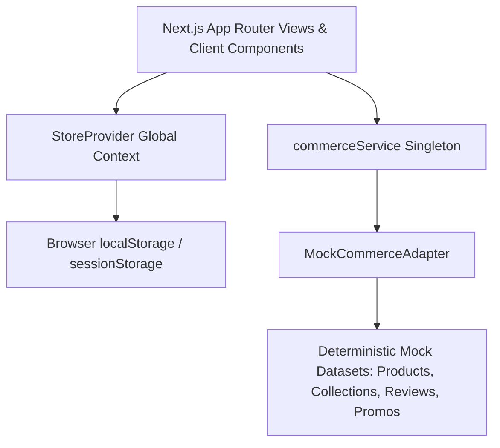

# Architecture Overview

## System Context
This storefront is a **100% frontend-only luxury minimalist jewellery e-commerce application**. All product discovery, variant selection, filtering, search, wishlist management, shopping bag operations, simulated checkout, and permissive demo account sessions run entirely in the browser backed by deterministic mock datasets and replaceable TypeScript service interfaces.

## Core Principles
1. **Zero Backend Dependency**: No external database, payment gateway, or authentication server is invoked.
2. **Replaceable Service Contracts**: UI components query `commerceService.catalog`, `commerceService.reviews`, and `commerceService.promotions` defined in `src/commerce/contracts/index.ts`.
3. **Resilient Studio Imagery**: All product studio angles and editorial campaign banners are generated deterministically via `src/lib/artwork.ts` SVG Data-URIs, guaranteeing zero broken images offline or in sandboxed environments.
